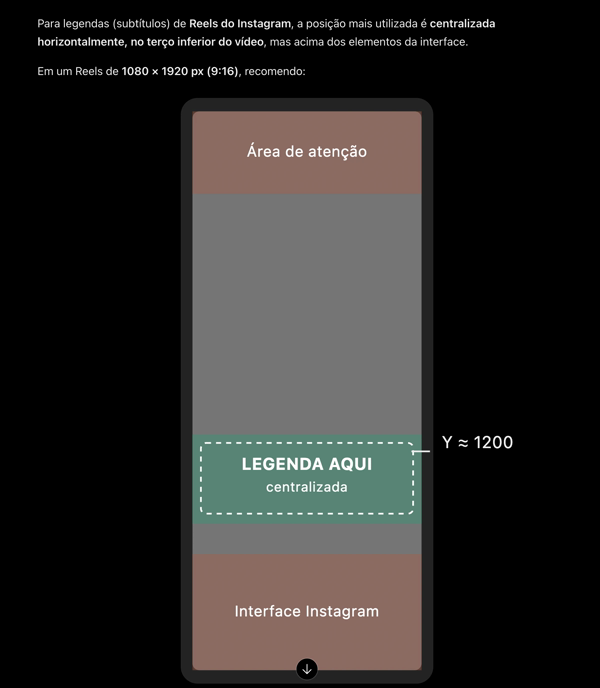
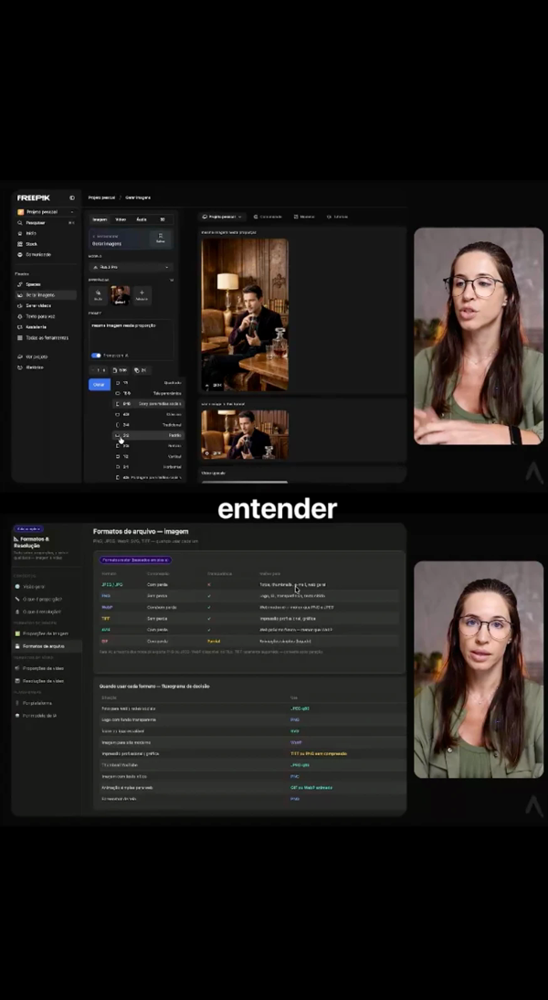

# Aprendizados · Legenda

O que já foi aprendido nesta área, vídeo a vídeo (como gravar: `etapas/14-concluir.md`). Leia antes de trabalhar nela
e não repita estes erros. **[gosto]** = preferência confirmada pelo criador · **[defeito]** = erro técnico.

## Do criador

- **[gosto] Posição da legenda (todo vídeo), em três casos.** _criadora · 2026-10-18_
  1. **Padrão:** centralizada na largura, no terço de baixo, a ~62,5% da altura (Y ≈ 1200 em 1080×1920), acima da
     interface do Instagram; sempre a mesma altura (`legenda_rostos.py --y 0.625`). 
  2. **Duas mídias empilhadas** (duas aulas, dois inserts independentes, uma em cima da outra): a legenda fica no
     meio, entre as duas. 
  3. **Rosto (dela ou de um insert):** desvia de olho, nariz e boca, com passo pequeno; pode ficar no rosto, fora
     desses pontos. 
- **[gosto] Legenda palavra por palavra** nos próximos vídeos (`legenda.modo: palavra`, o padrão). O 3 coisas FAI saiu por frase,
  a pedido, para o teste com o estilo do anúncio; não é o padrão. _3-coisas-fai · 2026-10-14_
- **[gosto]** Nunca sobre olhos, nariz ou boca, nem nos inserts e motions com rosto. Vale para todo vídeo (Reels e anúncios). Rode `legenda_rostos.py` em toda versão antes de entregar (pulado no CTA LP ext, a legenda caiu no rosto). _ficha-personagem-ia·v6.7; cta-lp-ext·v4 c6 · 2026-10-15_
- **[gosto]** Nunca abaixo da área visível do Instagram (80% da altura). Vale para todo vídeo. Limite em `render/src/legenda.ts` e `ferramentas/legenda_rostos.py`. _cta-lp-ext·v8 c2, c3 · 2026-10-15_

## Técnicos (do editor)

- **[defeito] A legenda nunca cobre o conteúdo.** Num insert de tela cheia com mídia horizontal, ela vai abaixo da
  mídia, não no meio da tela — corrigido em `render/src/legenda.ts`. Em outros casos em que ainda cubra algo
  importante, vire nota para o criador. _1º teste; mvi-0717 · 2026-10-12_
- **[técnica]** Com a altura padrão, a legenda desvia em degraus pequenos, conta só os rostos (não miniaturas) e só olha os quadros do próprio plano — corrigido em `legenda_rostos.py`. _gpt-image-glow · 2026-10-18_
- O transcritor escreve "Cloud" para "Claude": corrija a grafia na legenda (`ajustes`). _1º teste_

## Anúncios (CTAs) — só para anúncio; Reels têm outra lógica

- **[gosto]** A legenda nunca fica por cima da assinatura do final. _ficha-personagem-ia·v5 · 2026-10-15_
