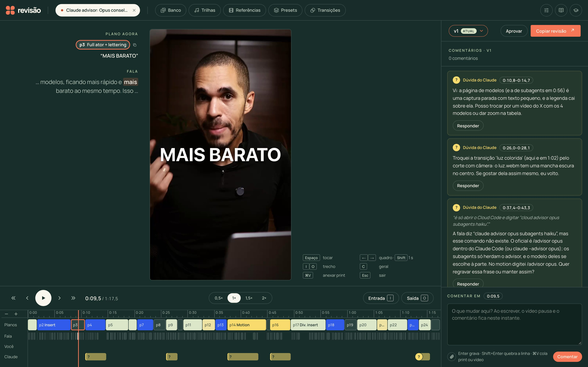

# agent-video-editor

Um editor de Reels por linguagem natural: o **Claude Code é o editor**. Você manda o vídeo bruto (e, se quiser, um
briefing) e ele entrega a edição completa — cortes, 9:16, look, direção visual, inserts reais, motions, transições,
áudio e legenda. Você revisa num app local estilo frame.io, comenta no ponto exato do vídeo e cola a revisão de volta
no chat: ele aplica e renderiza a próxima versão.



## Como funciona

Tudo mora numa skill do Claude Code, em [`.claude/skills/editor/`](.claude/skills/editor/SKILL.md):

1. **Vídeo novo → v1, sem parar:** preparar (transcrição palavra a palavra, proxy, rosto, voz limpa) → cortes →
   direção (o roteiro dirigido, plano a plano) → inserts, motions, áudio, legenda e transições em paralelo →
   enriquecimento → render e autorrevisão.
2. **Revisão:** você comenta no app e clica em *Copiar revisão*; colada no chat, ela vira a v(N+1), com uma resposta
   para cada comentário.
3. **Aprovado:** exporta o final e conclui o vídeo — as correções viram aprendizados (só os que você confirmar), lidos
   antes de cada etapa nos próximos vídeos.

As decisões editoriais são do Claude, guiadas pelos exemplos do criador; os scripts validam, calculam tempos e
renderizam. Tudo fica preso às palavras da transcrição (IDs), nunca a segundos — o contrato está em
[`edicao.md`](.claude/skills/editor/edicao.md).

## Estrutura

| Pasta | O que tem |
|---|---|
| `.claude/skills/editor/` | `SKILL.md` (os fluxos), `etapas/` (um .md por etapa), `exemplos/`, `aprendizados/` |
| `ferramentas/` | um script por etapa (`uv run ferramentas/<script>.py`, dependências no próprio arquivo) |
| `render/` | a página que desenha inserts, motions e legenda para o render |
| `app/` | o app de revisão (HTML + JS puro) |
| `biblioteca/` | presets, transições, sons, trilhas, LUTs, motions e o banco de mídias (fora do git) |
| `projetos/` | um vídeo por pasta (fora do git) |

## Rodar

Precisa de [uv](https://docs.astral.sh/uv/), ffmpeg e o [Claude Code](https://claude.com/claude-code). As chaves ficam
num `.env` na raiz (nunca vão para o git):

```bash
OPENROUTER_API_KEY=...
ELEVENLABS_API_KEY=...
```

O app de revisão:

```bash
uv run ferramentas/servidor.py   # http://localhost:8719/app/
```

E no Claude Code, dentro da pasta: *"edite este vídeo: /caminho/do/bruto.mp4"*.
